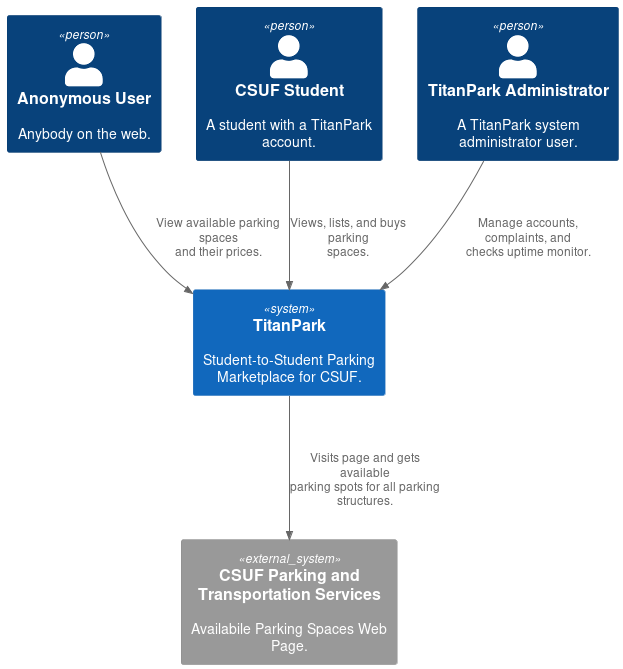
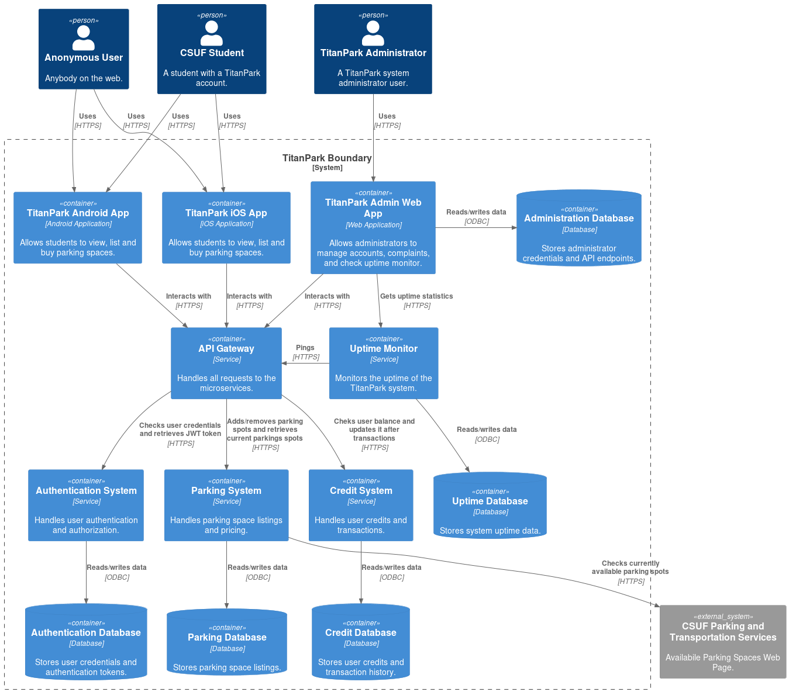
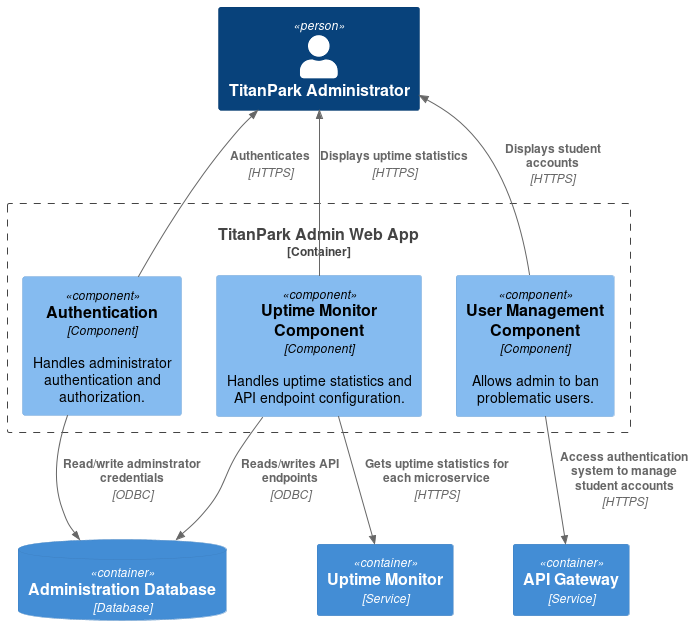

# Titan Park Architecure

## Table of Contents

- [Microservices and App Repos](#microservices-and-app-repos)
- [C4 System Architecture](#c4-system-architecture)
  - [Level 1: System Context](#level-1-system-context)
  - [Level 2: Containers](#level-2-containers)
  - [Level 3: Components](#level-3-components)
    - [TitanPark Admin Web App Components](#titanpark-admin-web-app-components)

<!-- Link to microservices repositories -->
## Microservices and App Repos

[TitanPark Flutter App](https://github.com/nathanchamorro1/titanpark) - Flutter application for TitanPark.

[TitanPark Parking System](https://github.com/santi224m/titanpark-parking-system) - This microservice handles parking space listings and dynamic pricing.

## C4 System Architecture
### Level 1: System Context

### Level 2: Containers

### Level 3: Components

#### TitanPark Admin Web App Components

